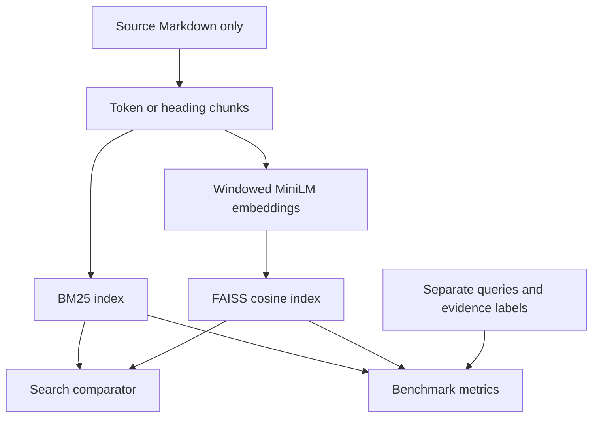

# SearchWorkbench — Semantic Search Benchmarker

A working search and evaluation app comparing **BM25 keyword search** with **dense semantic search** on technical documentation. It uses a free local MiniLM embedding model and an embedded FAISS index. **No API key or paid cloud account is required.**

## Quick start on Windows

You can run this while Docker Desktop is being set up for the networking assignment. This app uses port **8501**; the networking lab uses **8080**, so they do not conflict.

1. Extract this folder and open PowerShell inside the folder containing `pyproject.toml`.
2. With `uv` installed, run:

```powershell
uv sync --frozen
uv run streamlit run src/app.py
```

Open **http://localhost:8501**. Click **Build / load indexes**. The first build downloads the approximately 90 MB embedding model and builds the indexes. Keep the terminal open. Later builds reuse the downloaded model and cached document embeddings.

If `uv` is unavailable, install it following the [official uv instructions](https://docs.astral.sh/uv/getting-started/installation/), then open a new PowerShell window. The project pins Python 3.11; uv can download that Python version when needed.

## Docker submission option

The assignment permits a containerized demo instead of a public cloud deployment. Docker Desktop must be running with Linux containers.

```powershell
docker compose up -d --build
```

Open **http://127.0.0.1:8501** and click **Build / load indexes**. The first download requires internet access. Named volumes retain the model and generated benchmark reports.

For the video, run the tests in the container:

```powershell
docker compose exec search uv run --frozen pytest -v
```

To stop:

```powershell
docker compose down
```

The application, tests, and benchmark were executed natively while preparing this project. Docker could not be run in that environment, so the container build and end-to-end Docker demonstration still need verification on your machine. No cloud deployment is claimed.

## What is included

- **27 real FastAPI documentation pages**, bundled as Markdown with their MIT license, pinned source commit, URLs, and SHA-256 checksums.
- **24 curated evaluation queries:** 10 exact identifier lookups and 14 conceptual questions, including two questions requiring two evidence passages.
- **Four chunking strategies:** fixed 256, 512, and 1024 tokens, each with 32-token overlap, plus heading-based sections that preserve fenced code blocks.
- **Eight configurations:** BM25 and dense search for every chunking strategy. This includes all four required configurations and makes same-chunk comparisons possible.
- **384-dimensional MiniLM embeddings**, run on CPU through FastEmbed/ONNX, avoiding a large PyTorch/CUDA installation.
- **Side-by-side search**, distinct score labels, literal-term highlights, source lines, and chunk downloads.
- **Measured Hit Rate, Recall, MRR at K=3/5/10**, average/p50/p95 query latency, charts, JSON/CSV downloads, and failure comparisons.
- Automated tests, a saved AI draft and executed audit examples, measured benchmark evidence, Docker files, and a six-minute video guide.

## Architecture



| File / folder | Purpose |
| --- | --- |
| `corpus/` | 27 bundled original documentation pages and upstream license |
| `data/corpus_manifest.json` | Source revision, URLs, sizes, checksums |
| `data/eval_queries.json` | Questions and source evidence spans; never indexed |
| `src/chunking.py` | Fixed windows, heading splitting, source offsets |
| `src/indexer.py` | Shared BM25 tokenizer, MiniLM pooling, normalization, FAISS |
| `src/search.py` | Build and search all eight configurations |
| `src/benchmarker.py` | Stable labels, top-K metrics, measured timing |
| `src/app.py` | Streamlit comparator and evaluation dashboard |
| `tests/` | Chunking, search, metrics, corpus integrity, dashboard tests |
| `docs/` | Audit, actual preparation evidence, video notes, submission text |

## Run tests and benchmark

```powershell
uv run pytest -v
uv run python scripts/run_benchmark.py
```

The full tests include real local model inference, not a mock semantic substitute. First use may download the model. To run only the tests that do not need model inference:

```powershell
uv run pytest -v -m "not integration"
```

The CLI writes `artifacts/benchmark.json` and `artifacts/benchmark.csv`. The dashboard's **Run Benchmark** button uses the same engine and lets you download the results. Historical preparation results are in [docs/measured-benchmark.csv](docs/measured-benchmark.csv); they are not automatically displayed as a fresh dashboard run.

The included GitHub Actions workflow runs tests and benchmarks after the project is pushed. Its results do not exist until it actually runs in your repository.

## What the metrics mean

- **Hit Rate@K:** fraction of questions with at least one labeled evidence passage in the first K results.
- **Recall@K:** fraction of each question's unique labeled evidence passages retrieved, averaged across questions. Overlapping chunks do not count the same passage twice.
- **MRR@K:** average reciprocal rank of the first relevant result. A miss, including a relevant result below K, receives zero.
- **Latency:** measured warm, serial query execution, including dense query embedding and ranking. Model download, index building, dashboard rendering, and initial warm-up are excluded. Index build time is recorded separately. One search at maximum K is reused for all metric slices, so K rows are not independently timed searches.

Labels are document names plus exact source passages, not chunk array positions. A chunk is relevant only if its original source offsets fully contain a labeled passage. Every label is checked for coverage in every configuration before benchmarking; failures are raised rather than silently dropping questions.

## Important limitations and audit decisions

1. **Large chunks are not silently truncated.** MiniLM accepts 256 input tokens. The encoder splits long text into model-sized windows, embeds all windows, takes a token-weighted mean, and normalizes it. A 1024-token chunk is therefore a pooled representation, not a native long-context transformer input.
2. **FAISS is exact in this project.** `IndexFlatIP` searches unit-length vectors using cosine similarity. This small corpus does not test ANN scale, HNSW, or billion-vector throughput.
3. **The fixed-token baseline may cut code blocks.** That is an explicit experimental weakness, not hidden repair logic. Heading-based chunks preserve fences. Unicode boundaries are adjusted to avoid corrupting characters while retaining exact overlap in the original token stream.
4. **This is a curated development set.** No training occurs, but the questions and labels are manually selected. They are not held-out production traffic. Do not claim universal search superiority from these results.
5. **Chunk size changes context budget.** A top-5 set of large chunks can expose more text than five small chunks. Quality at equal K does not establish quality at an equal answer-context token budget. Heading sections also vary in length.
6. FastAPI-specific include directives are retained as source references rather than expanded external code snippets. The source text is original Markdown, not a full rendered-documentation mirror.
7. BM25 scores and cosine similarities have different meanings and cannot be compared numerically across methods. Dense search returns nearest neighbors even if the question is unrelated; there is no calibrated relevance threshold here.
8. This is a local academic workbench, without public hosting authentication or production traffic hardening.

Read [the AI audit log](ai_prompt_log.md) for exact source functions and verified mathematical errors in the saved draft.

## Suggested live demo queries

Use **structure** chunking and **K=5**:

- Exact query: `WebSocketDisconnect receive_text exception`
- Conceptual query: `How do I stop overly long text from being accepted as an input?`

These were selected from the measured development benchmark to illustrate actual contrasts, not to represent all queries. See [docs/results-notes.md](docs/results-notes.md) for observed ranks and limitations. Verify the outcome of your own run before describing it in the video.

## GitHub

Create an empty repository named **semantic-search-benchmarker** in your GitHub account, then run from this project folder:

```powershell
git init
git add .
git commit -m "Add search comparator and retrieval benchmark"
git branch -M main
git remote add origin https://github.com/Elenimulu789/semantic-search-benchmarker.git
git push -u origin main
```

If the repository was initialized with files, reconcile those changes first instead of force-pushing. No repository was created by this package.

## Recording and submission

Use [the simple video notes](docs/video-walkthrough.md). The assignment requires **5–7 minutes with screen and face visible throughout**. The submission template is [docs/submission.md](docs/submission.md). This package does not include a recorded video or a fabricated hosted URL.

## Troubleshooting

- **Port 8501 is busy:** close the other Streamlit app, or stop its terminal with Ctrl+C. The networking lab on port 8080 can remain running.
- **Model download fails:** check internet access and retry. No Hugging Face account/token is required for the public model. If the optional Xet transfer fails, set `$env:HF_HUB_DISABLE_XET="1"` in PowerShell before starting the app. Do not disable TLS verification.
- **Optional offline mode:** after the model is downloaded, set `$env:HF_HUB_OFFLINE="1"`. First use cannot be offline.
- **A stale/corrupted embedding cache:** stop the app and remove `.cache/embeddings`, then rebuild. This does not remove the downloaded model.
- **Source checksum test fails:** restore the original corpus, or deliberately refresh it with `uv run python scripts/fetch_corpus.py` and review every evidence label. Refreshing changes the experiment and can make saved results stale.
- **Windows FAISS wheel installation fails:** use the supplied Docker option with Python 3.11/Linux.

## References

- [FastAPI source and MIT license](https://github.com/fastapi/fastapi)
- [MiniLM model card and input limit](https://huggingface.co/sentence-transformers/all-MiniLM-L6-v2)
- [FastEmbed](https://qdrant.github.io/fastembed/)
- [FAISS distance metrics](https://github.com/facebookresearch/faiss/wiki/MetricType-and-distances)
- [rank-bm25](https://github.com/dorianbrown/rank_bm25)
- [Streamlit testing](https://docs.streamlit.io/develop/api-reference/app-testing)
